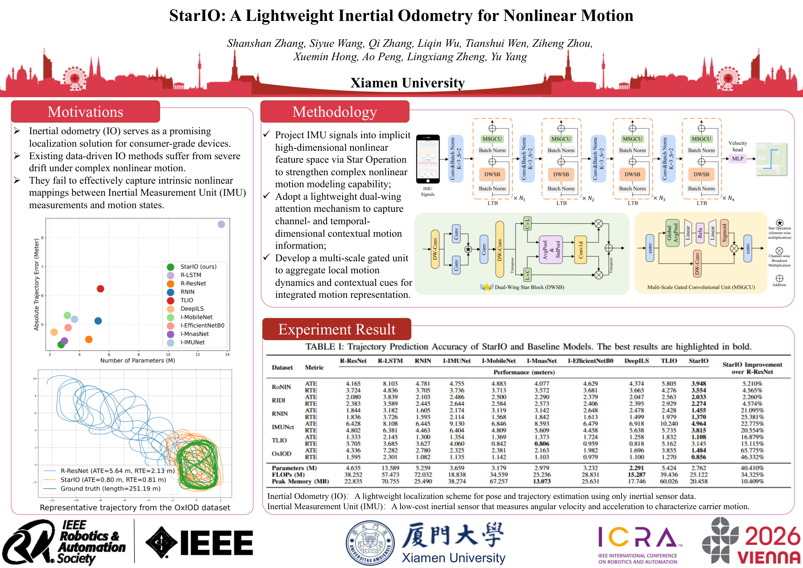

# Hi, I'm 233 👋

### Artificial Intelligence · Inertial Positioning · Embedded Systems

  
  
  
  
  

---

### 👨‍💻 关于我

我是一个做嵌入式开发、基于神经网络的惯性定位，还有人工智能应用开发的。

- 🎓 **学历背景**：
  - 厦门大学信息学院，通信工程，**工学硕士**
  - 厦门大学电子科学与技术学院，电子信息科学与技术，**工学学士**

---

### 🚀 核心项目与成果矩阵

根据领域研究与工程实践，开源成果分为三大核心板块（支持直达在线体验）：

| 研究 / 工程领域 | 项目与体验入口 (点击直达) | 核心亮点与一句话介绍 |
| :--- | :--- | :--- |
| **嵌入式相关 (Embedded)** | [**esp32-openblock**](https://bug423.github.io/esp32-openblock/) 🌐 🌐 [在线体验](https://bug423.github.io/esp32-openblock/) · 💻 [源码仓库](https://github.com/BUG423/esp32-openblock) | 面向创客教育的跨平台图形化积木编程与代码生成系统（Web / Tauri 原生双端） |
| | [**esp32-web-tools**](https://bug423.github.io/esp32-web-tools/) 🌐 🌐 [在线体验](https://bug423.github.io/esp32-web-tools/) · 💻 [源码仓库](https://github.com/BUG423/esp32-web-tools) | 基于 Web Serial API 构建的浏览器免驱动 ESP32 固件一键烧录与串口调试平台 |
| | [**esp32-lab**](https://github.com/BUG423/esp32-lab) 💻 [源码仓库](https://github.com/BUG423/esp32-lab) | 涵盖多模态交互、传感器驱动与边缘计算的 ESP32 开源硬件实验项目与固件集合 |
| **定位相关 (Positioning & AI)** | [**app-inertial-lab**](https://github.com/BUG423/app-inertial-lab/releases/latest) 📦 📦 [下载 APK (v1.1.0)](https://github.com/BUG423/app-inertial-lab/releases/latest) · 💻 [源码仓库](https://github.com/BUG423/app-inertial-lab) | 融合 200Hz 高精 IMU 与 ARCore VIO 的 Android 端真机轨迹采集与端侧评测应用 |
| | [**other-blocks**](https://github.com/BUG423/other-blocks) 💻 [源码仓库](https://github.com/BUG423/other-blocks) | 面向计算机视觉与惯性定位时序感知任务的即插即用 PyTorch 神经网络模块库 |
| **人工智能应用与工具 (AI & Other)** | [**xmu-nav**](https://bug423.github.io/xmu-nav/) 🌐 🌐 [在线体验](https://bug423.github.io/xmu-nav/) · 💻 [源码仓库](https://github.com/BUG423/xmu-nav) | 聚合厦大常用网站、校园生活、学术科研与在线工具的极速校园导航门户 |
| | [**xmu-grad-guide**](https://bug423.github.io/xmu-grad-guide/) 🌐 🌐 [在线体验](https://bug423.github.io/xmu-grad-guide/) · 💻 [源码仓库](https://github.com/BUG423/xmu-grad-guide) | 为信息学院研究生量身定制的毕业流程拆解、任务清单与进度一站式看板系统 |
| | [**app-stock-agent**](https://github.com/BUG423/app-stock-agent) 💻 [源码仓库](https://github.com/BUG423/app-stock-agent) | 基于大语言模型与多智能体协同的股票行情监控、多模态内容分析与策略推理系统 |
| | [**app-remote-terminal**](https://github.com/BUG423/app-remote-terminal) 💻 [源码仓库](https://github.com/BUG423/app-remote-terminal) | 支持多会话隔离、远程安全访问与智能 Coding Agent 深度集成的浏览器交互式终端 |
| | [**app-quiz-forge**](https://github.com/BUG423/app-quiz-forge) 💻 [源码仓库](https://github.com/BUG423/app-quiz-forge) | 基于 Excel 题库零配置导入的跨平台自主练习、错题强化与考试评估工具 |
| | [**app-ai-lover**](https://github.com/BUG423/app-ai-lover) 💻 [源码仓库](https://github.com/BUG423/app-ai-lover) | 基于大语言模型与多模态情感交互的沉浸式伴侣桌面与移动端应用 |

---

### 🔬 代表性科研成果

**学术论文**
- **IONext: Unlocking the Next Era of Inertial Odometry**  
  *IEEE Robotics and Automation Letters (RA-L)* · **第一作者** · [IEEE Early Access (DOI: 10.1109/LRA.2026.3709641)](https://doi.org/10.1109/LRA.2026.3709641) · [arXiv](https://arxiv.org/abs/2507.17089)

- **StarIO: A Lightweight Inertial Odometry for Nonlinear Motion**  
  *ICRA 2026* · **第一作者** · [Paper](https://arxiv.org/abs/2507.16121) · [Poster (PDF)](assets/posters/poster_stario_icra2026.pdf)  
  

    
  

   

- **FTIN: Frequency-Time Integration Network for Inertial Odometry**  
  *ICASSP 2026* · **第一作者** · [Paper](https://arxiv.org/abs/2507.16120)

- **Boosting Knowledge Distillation via Local Categories Similarity Scaling**  
  *ICASSP 2026* · **第二作者**

**授权发明专利**
- **一种动态融合惯性、视觉与先验信息的定位方法** · **第二发明人** (授权)

---

### 🏆 主要荣誉与奖项

- 🥇 **2022 全国大学生嵌入式芯片与系统设计竞赛** · **国家级一等奖、最高奖“龙芯中科杯”**
- 🥇 **2022 全国大学生物联网设计竞赛（华为杯）** · **国家级一等奖**
- 🥈 **2023 国际室内定位和室内导航大赛（IPIN Competition）** · **全球第二名**
- 🥉 **2024 首届全国大学生职业规划大赛** · **全国铜奖**
- 🥇 **2022 全国大学生电子设计竞赛** · **省级一等奖**
- 💰 **国家励志奖学金**（2020、2021）、华为“智能基座”奖学金（2021、2022、2023）

---

### 💼 实践与实习经历

- **算法开发实习生 · 厦门松霖科技股份有限公司**（2022.07 – 2022.08）
- **厦门大学人工智能社团社长 · 华为云校园大使**（2020.09 – 2022.09）

---

## 📊 GitHub Footprint

  
  

**Research rigorously. Build responsibly.** 🚀

